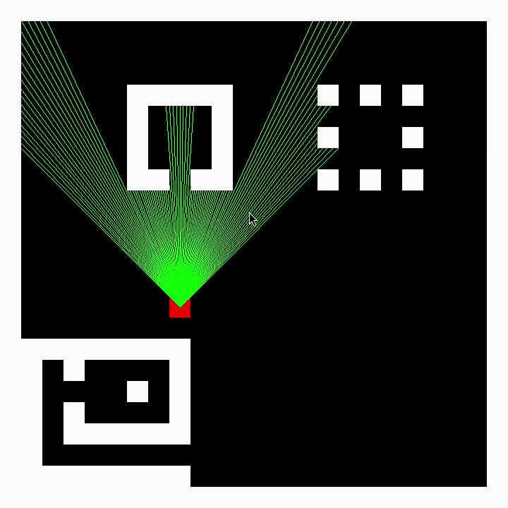

# A Simple Raycaster with C

A small raycasting project written in C with SDL2, built to learn how
Wolfenstein-style 3D rendering works.

<p align="center">
  
</p>

- Tile-based world map (24x24)
- Player with position and rotating view direction
- Field-of-view fan of rays using DDA grid traversal, so each ray stops
  exactly on the wall face
- Top-down debug view of the map, player, and rays
- CMake build

## Build & run

```bash
cmake -B build
cmake --build build -t run
```

Requires SDL2 and a C compiler.

## Controls

- W/A/S/D: move
- Q/E: rotate
